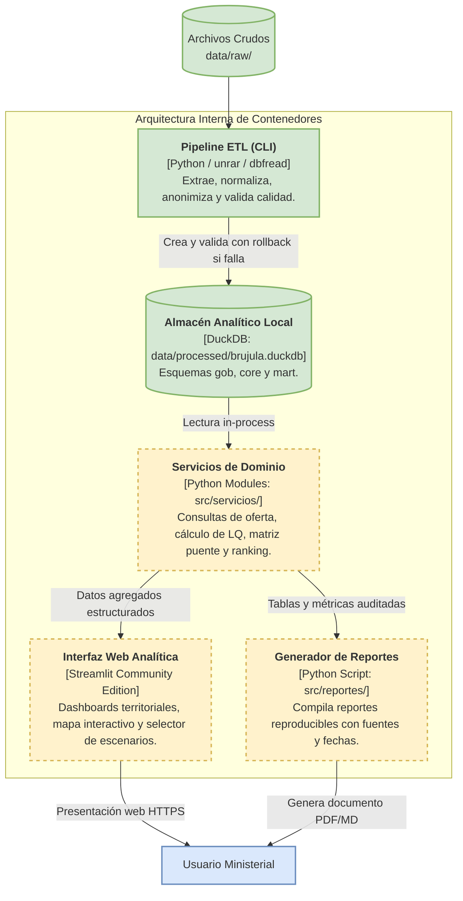
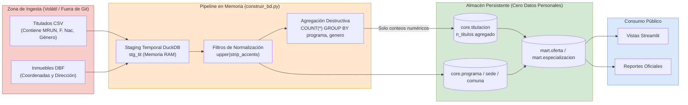

# Arquitectura Mínima del Sistema — Brújula IA Regional

**Estado**: Arquitectura Evaluada y Validada para Modernización Controlada  
**Fecha**: 2026-10-16  
**Principios Rectores**: Simplicidad técnica, preservación de lo existente, minimización de dependencias y separación estricta entre observación analítica e interfaz.

---

## 1. Evaluación Tecnológica del Stack

### 1.1 Justificación del Stack Existente

| Componente | Tecnología | Evaluación Técnica | Decisión |
|---|---|---|---|
| **Gestor de Entorno** | `uv` (Astral) | Excelente. Resuelve dependencias en milisegundos, asegura reproducibilidad determinística mediante `uv.lock` y gestiona la versión de Python de forma hermética. | **MANTENER** |
| **Motor de Base de Datos** | DuckDB (1.1+) | Sobresaliente para OLAP. Motor columnar embebido vectorizado. Procesa 328k filas en < 2 segundos sin sobrecarga de red ni daemon de servidor. Soporta esquemas (`gob`, `core`, `mart`), funciones ventana y DDL estándar. | **MANTENER** |
| **Lenguaje Base** | Python (3.12+) | Estándar de la industria en ciencia de datos y políticas públicas. Tipado estricto (`__future__.annotations`). | **MANTENER** |

> [!NOTE]
> **Descarte de PostgreSQL / PostGIS en esta fase**: DuckDB cubre el 100% de los requerimientos analíticos del MVP. Migrar a PostgreSQL añadiría fricción operativa injustificada (servidor de base de datos, credenciales, configuración de red, costos de hosting) sin aportar ventajas al usuario del Ministerio, dado que el producto es una herramienta de consulta analítica, no un sistema transaccional de alta concurrencia de escrituras.

### 1.2 Evaluación de Alternativas de Interfaz (Decisión D7 / #17)

| Alternativa | Ventajas | Desventajas | Veredicto |
|---|---|---|---|
| **Opción A: Streamlit** | 100% Python; integración directa in-process con DuckDB; desarrollo acelerado de dashboards interactivos con filtros, tablas y mapas; despliegue gratuito en Streamlit Community Cloud. | No expone una API REST para terceros; re-ejecución del script en interacciones complejas (mitigable con `@st.cache_data`). | **RECOMENDADA PARA MVP** |
| **Opción B: FastAPI + React** | Arquitectura desacoplada; API pública consumible por otros sistemas ministeriales; contratos OpenAPI formales. | Cuadruplica el esfuerzo de desarrollo y mantenimiento; requiere gestionar CORS, estado en frontend, despliegue de dos servicios independientes. Inviable para los plazos del MVP. | **POSTERGAR PARA FASE 2** |
| **Opción C: Solo CLI / Reporte Estático** | Máxima simplicidad; 0 dependencia de servidores web; generación directa de informes reproducibles en Markdown/PDF. | Baja interactividad; no permite a los analistas explorar escenarios de sensibilidad de forma dinámica. | **COMPONENTE COMPLEMENTARIO (REPORTE)** |

**Conclusión Arquitectural**: Se adopta una arquitectura monolítica modular en Python: **DuckDB como almacén embebido + Streamlit como interfaz analítica interactiva + Script CLI generador de reportes**. No se introducen microservicios ni APIs intermedias innecesarias.

---

## 2. Diagramas C4

### 2.1 C4 Nivel 1: Contexto del Sistema

```mermaid
flowchart TD
    subgraph Usuarios["Usuarios y Actores"]
        A["Analista Ministerial<br/>(Ministerio de Economía)"]:::actor
        B["Responsable del Programa<br/>(Tomador de Decisión)"]:::actor
        C["Público General / IES<br/>(Consulta de Oferta)"]:::actor
    end

    subgraph Sistema["Sistema Brújula IA Regional (Límite del Sistema)"]
        S["<b>Brújula IA Regional</b><br/>Plataforma analítica de focalización territorial de subsidios a tesis con IA"]:::existing
    end

    subgraph Externos["Sistemas y Fuentes Externas"]
        E1["Mineduc / SIES<br/>(Titulados y Catastro de Carreras)"]:::existing
        E2["IDE Chile / Geoportal<br/>(Inmuebles de Educación Superior)"]:::existing
        E3["Fuentes Económicas y Demanda<br/>(INE, SII, Banco Central, SENCE)"]:::proposed
        E4["Índices de Inteligencia Artificial<br/>(OIT, FMI, Literatura Científica)"]:::proposed
    end

    A -->|Consulta oferta y analiza escenarios| S
    B -->|Obtiene reportes y prioridades territoriales| S
    C -->|Explora oferta académica regional| S

    E1 -.->|Archivos CSV / RAR| S
    E2 -.->|Shapefiles / DBF| S
    E3 -.->|Datos de demanda y empleo (Pendiente)| S
    E4 -.->|Indicadores de exposición tecnológica (Pendiente)| S

    classDef existing fill:#d5e8d4,stroke:#82b366,stroke-width:2px;
    classDef proposed fill:#fff2cc,stroke:#d6b656,stroke-width:2px,stroke-dasharray: 5 5;
    classDef actor fill:#dae8fc,stroke:#6c8ebf,stroke-width:2px;
```

*Leyenda*: Verde continuo = Existente e implementado. Amarillo punteado = Propuesto / Bloqueado por fuentes externas.

---

### 2.2 C4 Nivel 2: Contenedores del Sistema



---

## 3. Diagrama de Flujo de Datos (DFD) y Política de Privacidad



### Reglas de Flujo y Seguridad
1. **Destrucción de Microdatos**: La tabla `stg_tit` se crea como tabla temporal volátil (`CREATE TEMP TABLE stg_tit`). Al cerrarse la conexión en `construir_bd.py`, DuckDB libera la memoria y ningún microdato persiste en disco.
2. **Invariante Cero Identificadores**: El pipeline ejecuta la consulta de inspección sobre `information_schema.columns` antes de renombrar la base a definitiva. Si existe cualquier columna sospechosa de datos personales, el proceso aborta inmediatamente.
